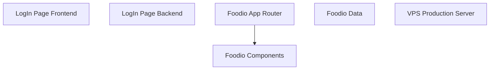

# 100 Days of Web Development - Learning Repository

A structured learning repository documenting a 100-day web development journey. Covers front-end and back-end development with real-world projects including a login system, a restaurant website built with Next.js, and VPS production deployment.

## Architecture / How it Works




---

## Contents

| Folder | Description | Key Concepts |
|--------|-------------|--------------|
| `LogIn Page/` | Full-stack login page with backend authentication | HTML/CSS frontend, Node.js backend, user authentication, form handling |
| `Restaurant Website/` | Restaurant website ("Foodio") built with Next.js and Tailwind CSS | Next.js App Router, TypeScript, Tailwind CSS, admin panel, food menu, order management |
| `VPS Production/` | VPS deployment setup with client-server architecture | Server deployment, Express.js, environment configuration, production hosting |

---

## Project Details

### LogIn Page
A complete login system with:
- Frontend: HTML and CSS login form
- Backend: Node.js/Express server (`backend/server.js`)
- User authentication flow

### Restaurant Website (Foodio)
A modern restaurant application built with Next.js featuring:
- App Router with multiple pages (food menu, my orders, sign-in)
- Admin panel for restaurant management
- Responsive design with Tailwind CSS and PostCSS
- TypeScript for type safety
- Image assets for hero sections, menu items, and UI elements

### VPS Production
Production deployment configuration with:
- Client-side application
- Express.js server (`Server/index.js`)
- Environment variable management (`.env`)
- Server configuration for VPS hosting

---

## Learning Phases

The 100-day plan is organized into three major phases:

| Phase | Days | Focus Area |
|-------|------|-----------|
| Front-End Development | Day 1 -- Day 65 | HTML, CSS, Bootstrap, Tailwind CSS, JavaScript, React/Angular |
| Back-End Development | Day 66 -- Day 85 | Node.js, APIs, Express.js |
| Databases and Deployment | Day 86 -- Day 100 | Git, MongoDB/MySQL/Firebase, final projects |

---

## Prerequisites

- **Node.js** (v18 or higher) and **npm** installed
- Basic understanding of HTML, CSS, and JavaScript
- A code editor such as VS Code
- (For VPS Production) Access to a VPS or cloud server

---

## How to Use

1. Clone this repository:
   ```bash
   git clone <repository-url>
   cd Web-Development
   ```

2. Run the Login Page project:
   ```bash
   cd "LogIn Page"
   npm install
   node backend/server.js
   ```
   Then open `index.html` in your browser.

3. Run the Restaurant Website:
   ```bash
   cd "Restaurant Website/foodio"
   npm install
   npm run dev
   ```
   Visit `http://localhost:3000` in your browser.

4. Explore the VPS Production setup:
   ```bash
   cd "VPS Production/Server"
   npm install
   node index.js
   ```

---

## Resources

- [Next.js Documentation](https://nextjs.org/docs)
- [Tailwind CSS Documentation](https://tailwindcss.com/docs)
- [Express.js Documentation](https://expressjs.com/)
- [Node.js Documentation](https://nodejs.org/docs/)
